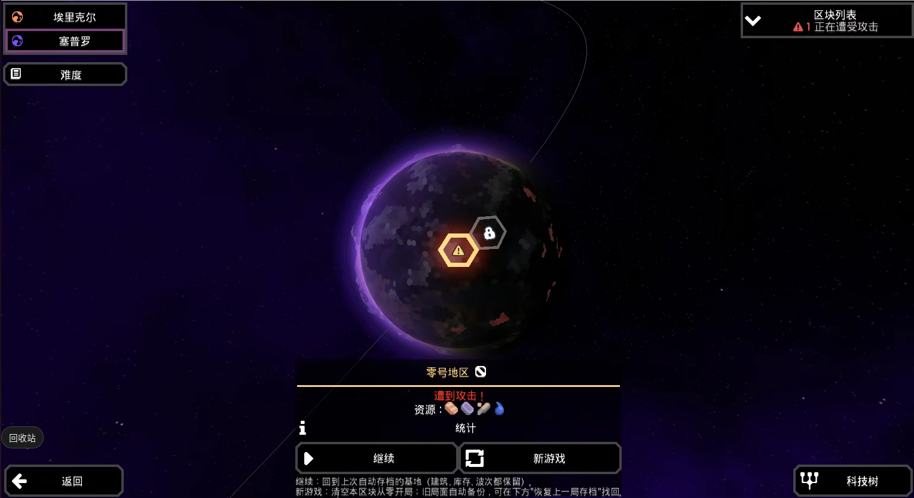
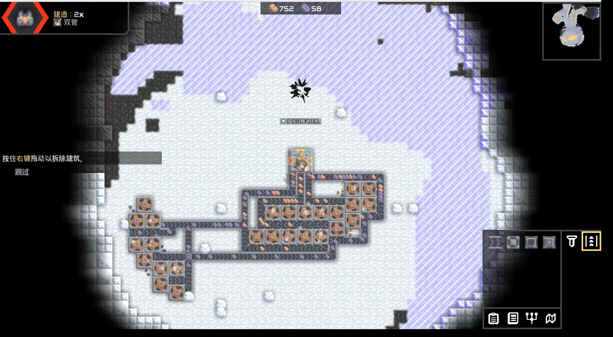

# Mindustry-UX

An **unofficial**, campaign-focused modified version of [Anuken/Mindustry](https://github.com/Anuken/Mindustry).

Mindustry-UX is maintained by WaterOfbigRiver. It is not affiliated with, endorsed by, or supported by Anuken or the official Mindustry project.

## Public feature scope

The first public prerelease intentionally contains only a small, independently validated feature set:

- **Reliable campaign wave countdowns:** campaign world loading enables the automatic wave timer even when a sector map stores `waveTimer=false`.
- **Clear sector actions:** a sector with an existing save offers separate **Resume** and **New Game** actions.
- **Previous-run recovery:** starting a new game backs up the previous sector save and its sector information first. **Restore Previous Save** can load that backup after confirmation.

Experimental developer UI, control changes, unlimited storage, internal documents, local settings, and other unvalidated changes are not part of this repository's public branch.

English, Simplified Chinese, and Traditional Chinese strings are included for the new sector actions.

## Screenshots





These screenshots are captured from the corresponding public prerelease. They contain no player accounts, local paths, or private saves.

## Download

See [Releases](https://github.com/WaterOfbigRiver/Mindustry-UX/releases). Each release lists the exact source commit used for its JAR files and provides SHA-256 checksums.

The initial `v0.1.0-alpha.1` prerelease provides desktop and headless server JARs. It does **not** provide an Android APK. Back up your game data before trying a prerelease; save compatibility with future versions is not guaranteed.

### Backup behavior

- One explicit previous-run backup is kept per sector.
- Starting another new game for the same sector replaces that explicit backup.
- Restoring a backup overwrites the current sector save after confirmation.
- Backups are local files and are not synchronized to a cloud service.

## Build from source

Use **JDK 17**. Other JDK versions are not supported by this build baseline.

```bash
git clone --branch public-master --single-branch https://github.com/WaterOfbigRiver/Mindustry-UX.git
cd Mindustry-UX
./gradlew desktop:dist server:dist
```

On Windows, use `gradlew` instead of `./gradlew`.

Outputs:

- `desktop/build/libs/Mindustry.jar`
- `server/build/libs/server-release.jar`

Run the automated tests with:

```bash
./gradlew tests:test
```

The Gradle dependency is pinned through `archash`. CI fetches Arc commit `7445105cd2683daf5b9ac7033ebb07265d3e814d` explicitly instead of tracking Arc's moving `master` branch.

To run the desktop client locally:

```bash
./gradlew desktop:run
```

## Releases and tags

This fork uses its own `v0.1.x` prerelease tags. GitHub workflows do not push to Anuken/Arc, MindustryGame/docs, MindustryBuilds, or any other external repository. Release assets are built and reviewed before publication.

## Contributing and issue scope

Issues and pull requests in this repository should concern the public Mindustry-UX changes. Please report upstream-only problems to the appropriate official Mindustry repository instead. Do not attach private saves, credentials, tokens, signing keys, or personal paths.

## License and modification notice

The original [GNU General Public License version 3](LICENSE) is retained verbatim. Mindustry-UX modifications made on **2026-11-22** are distributed under the same GPLv3 terms, with no additional restrictions. Upstream copyright, source availability, and asset notices remain applicable.

The source corresponding to a published binary is available from the same release tag and its linked commit. This repository does not provide proprietary builds or private-source binaries under the Mindustry-UX name.
